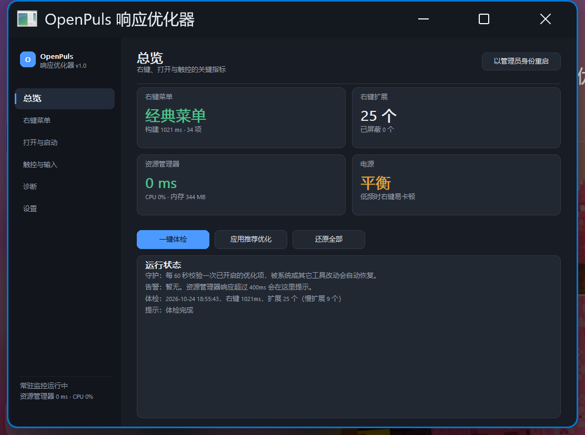
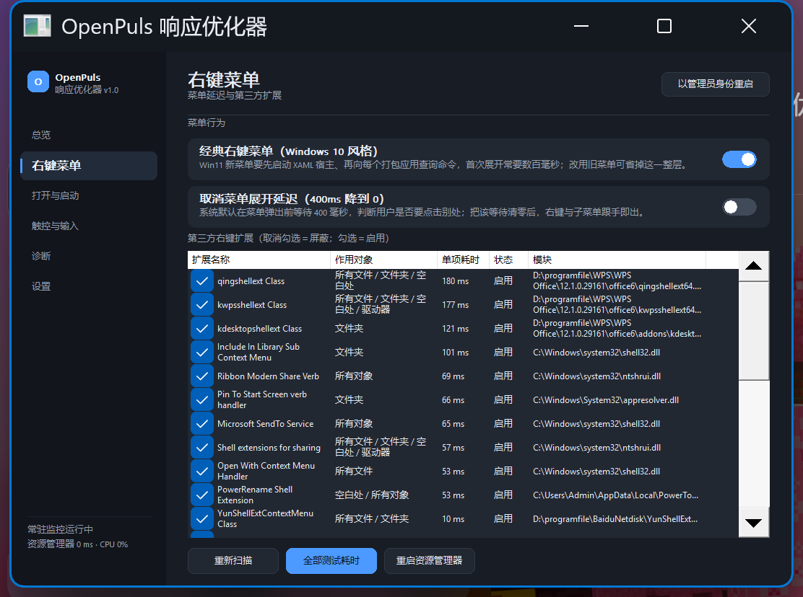
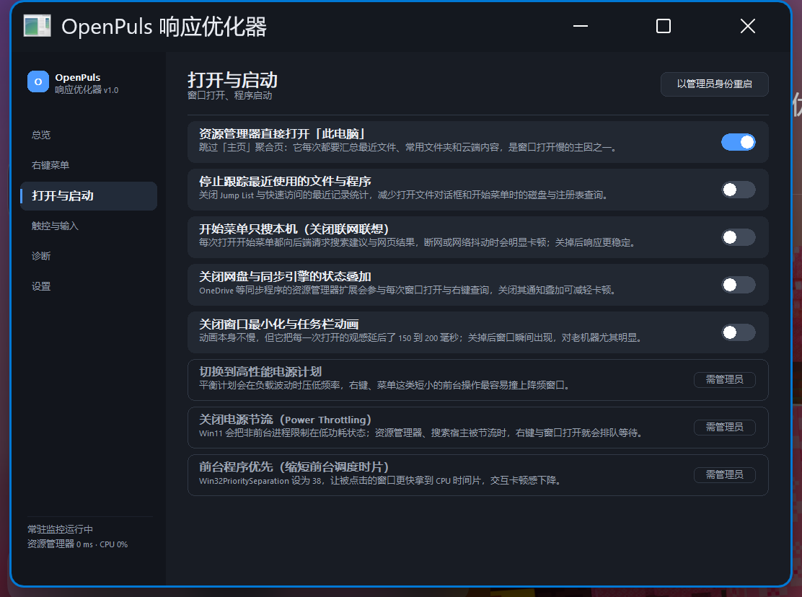
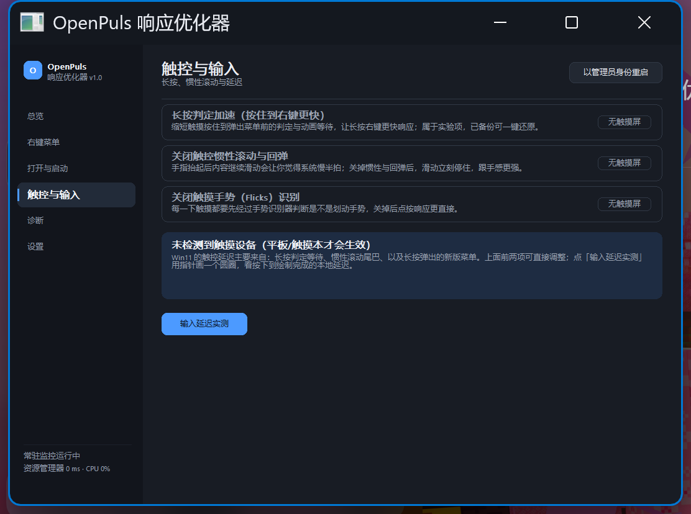
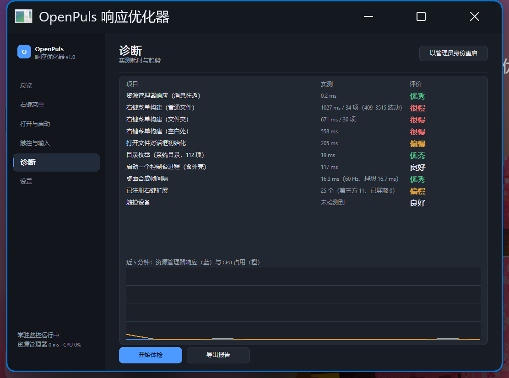
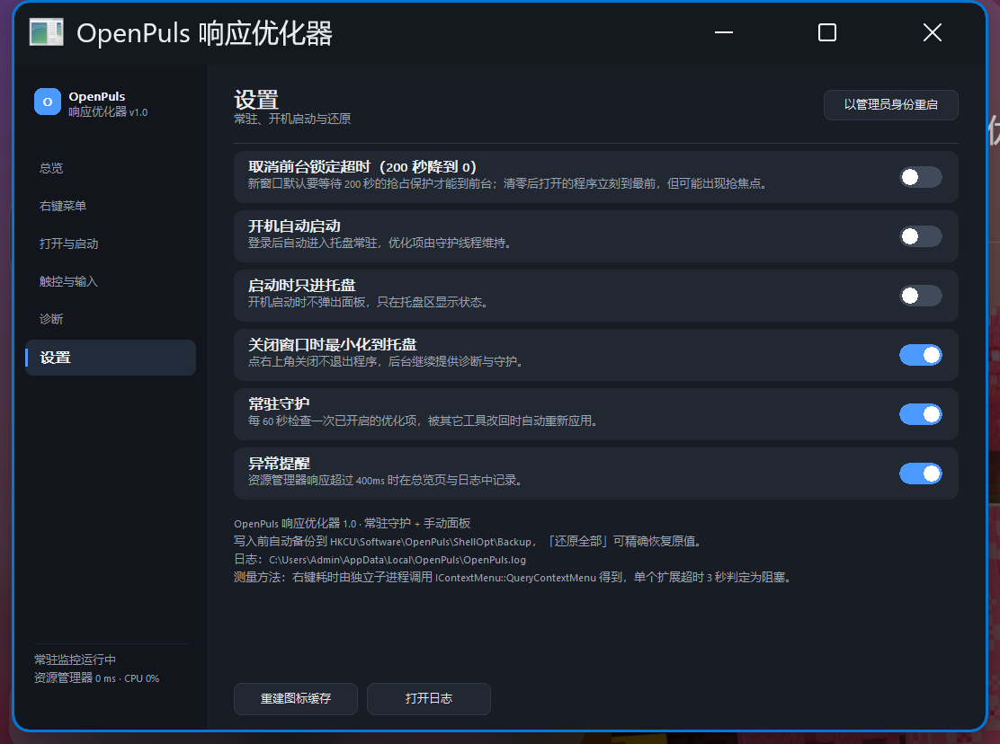
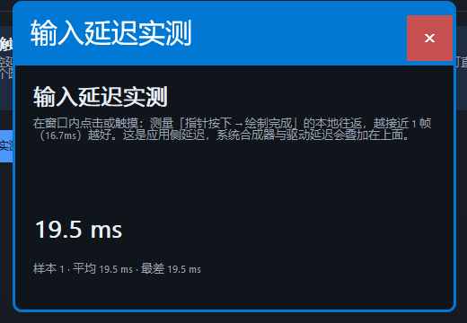

# OpenPuls 响应优化器

面向 Windows 11「右键菜单、打开文件/程序、触控」响应变慢的一个常驻小工具：
C++ 原生 Win32 实现，托盘常驻 + 后台守护 + 一个简要设置面板 + 可量化的体检报告。



## 它解决什么

Windows 11 在这三件事上普遍比 Windows 10 更"磨蹭"：

| 场景 | 主要成因（详见 [调研报告](docs/调研报告-Win11响应变慢.md)） |
| --- | --- |
| 右键菜单弹出慢 | 新菜单要先起 XAML 宿主、再逐一向各应用查询命令；旧式 `IContextMenu` 扩展在 explorer 进程内串行加载，没有超时保护 |
| 打开文件/程序慢 | "主页"聚合、最近记录、网盘同步叠加、开始菜单联网联想、电源节流 |
| 触控"慢半拍" | 长按判定等待、惯性滚动尾巴、长按弹出的是同一套慢菜单 |

本工具做三件事：

1. **量出来**——用独立子进程调用 `IContextMenu::QueryContextMenu`，逐个测出每个右键扩展的耗时（带 3 秒超时和崩溃隔离），再测对话框初始化、目录枚举、进程启动、DWM 帧间隔。
2. **改回来**——13 个可开关的优化项 + 右键扩展屏蔽，全部写注册表前自动备份，可一键精确还原。
3. **守住它**——常驻托盘，每 60 秒校验一次已开启的项，被系统更新或其他"优化大师"改回去会自动重新应用；同时监控 explorer 的响应与 CPU，异常写日志。

## 实测样例（本机 Windows 11 26200，右键 545–560 ms）

| 扩展 | 作用对象 | 单项耗时 |
| --- | --- | --- |
| qingshellext Class（WPS） | 所有文件 / 文件夹 / 空白处 | 208 ms |
| kwpsshellext Class（WPS） | 所有文件 / 文件夹 / 空白处 / 驱动器 | 163 ms |
| kdesktopshellext Class（WPS） | 文件夹 | 123 ms |
| Include In Library Sub Context Menu | 文件夹 | 119 ms |
| Ribbon Modern Share Verb | 所有对象 | 71 ms |
| Pin To Start Screen verb handler | 文件夹 | 69 ms |
| …（共 25 个扩展，其中第三方 11 个） | | |

三个 WPS 扩展就吃掉了 494 ms——**慢的不是"Windows 11"，是挂在右键上的这些进程内扩展**。它们全部在 explorer 的 UI 线程上串行加载，没有超时保护，任何一个卡住，整份菜单就卡住。

> 注意：把其中 3 个扩展屏蔽后，本机菜单总耗时的中位数并没有明显下降（约 402 ms → 386 ms，落在测量噪声内）。这符合"成本主要来自 25 个扩展的冷加载 + 数量"的判断：只去掉 3 个，剩下的 22 个仍要各自映射 DLL、初始化 COM。所以工具把**逐项归因**作为主视图，而不是给一个漂亮但虚的总分。

## 界面

| 右键菜单 | 打开与启动 |
| --- | --- |
|  |  |

| 触控与输入 | 诊断 |
| --- | --- |
|  |  |

设置页与输入延迟实测：




## 编译

需要 Visual Studio 生成工具（含"使用 C++ 的桌面开发"）与 Windows 10/11 SDK。

```bat
scripts\build.bat
```

或 PowerShell：

```powershell
.\scripts\build.ps1
```

产物：`build\OpenPulsShellOpt.exe`（单文件，静态链接 CRT，无需运行库）。

也可以用 CMake：

```bat
cmake -B build -A x64
cmake --build build --config Release
```

## 使用

1. 运行 `build\OpenPulsShellOpt.exe`，面板打开并自动体检一次（约 10–20 秒，取决于扩展数量）。
2. 总览页点「应用推荐优化」，会打开经典右键菜单、清零菜单延迟、关闭"主页"聚合/最近记录/联网联想等；涉及系统级的项（电源计划、节流、优先级）需要点右上角「以管理员身份重启」。
3. 「右键菜单」页会列出所有扩展与单项耗时，取消勾选即屏蔽（写入 `HKCU\...\Shell Extensions\Blocked`），重启资源管理器后生效。
4. 关闭窗口 = 收进托盘。托盘菜单可暂停守护、立即体检、重启资源管理器。
5. 想全部撤销：设置页或总览页点「还原全部」，备份在 `HKCU\Software\OpenPuls\ShellOpt\Backup`，还原后自动清理。

日志：`%LOCALAPPDATA%\OpenPuls\OpenPuls.log`
体检报告：诊断页「导出报告」→ `%LOCALAPPDATA%\OpenPuls\report-*.md`

## 优化项一览

右键菜单：经典右键菜单、菜单展开零延迟、第三方扩展屏蔽（按项）
打开与启动：直接打开「此电脑」、停止最近记录跟踪、关闭网盘同步叠加、开始菜单只搜本机、关闭窗口/任务栏动画、高性能电源计划、关闭电源节流、前台程序优先
触控：长按判定加速（实验）、关闭触控惯性与回弹、关闭 Flicks 手势
高级：取消前台锁定超时

每一项都写明了作用机理与副作用；实验项单独标注，默认关闭。

## 目录

```
src/           C++ 源码（util / tweaks / diag / monitor / ui / main）
res/           图标、清单、版本信息
scripts/       构建与截图辅助脚本
docs/          调研报告与界面截图
```

## 限制与说明

- 只能优化**软件层**：硬件、驱动、触摸屏本身的采样率不在可控范围，工具提供的是延迟实测窗口（应用侧指针→绘制往返），不是硬件延迟。
- 屏蔽扩展是"用户级"的，写在 `HKCU`，不需要管理员，也不影响其他账户。
- Win11 新版右键菜单本身由 explorer 的 XAML 宿主绘制，**无法脱离交互进程单独计时**；工具测的是同一份旧式扩展在菜单里的公共成本，这也是新版菜单"显示更多选项"里那一层的成本。
- 触控项属于社区经验参数（`Wisp\Touch`），并非微软公开文档承诺的接口，因此标为实验项并自动备份。
- 工具不联网、不上传任何数据。
- 若显示器缩放比例极端（例如 1080p 屏幕开 250%），面板会自动缩小但仍可能超出屏幕：可用环境变量 `OPENPULS_UI_SCALE=96` 强制按 96 DPI 布局（仅影响本工具自己的排版）。

许可证：MIT。
